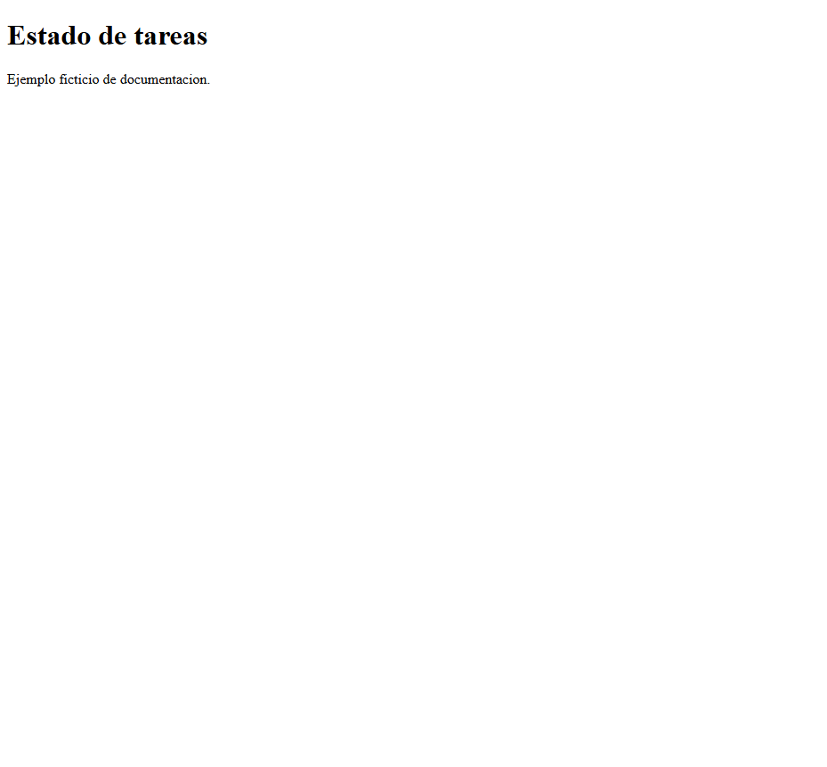

# DOC-001 · Escenario A: captura real de fixture

2026-11-06 09:59 CET. Ejemplo sintético, no producto de cliente. Se ejecutó temporalmente un servidor Python `http.server` sobre `127.0.0.1`, con un `index.html` que muestra «Estado de tareas» y «Ejemplo ficticio de documentación». El navegador Playwright abrió la página servida y guardó la captura real `EJEMPLO-CAPTURA-WEB.png` en esta carpeta; SHA-256 `6bae33d7f26acd7c7e0148033192837a8db2f9abf62e1c24ac18833eea17c6e5`. La imagen se inspeccionó visualmente y no contiene datos personales ni credenciales. El servidor respondió HTTP 200 para `/`; registró 404 para `favicon.ico`, ausente del fixture. Después se cerraron navegador y servidor. El intento anterior con Edge headless falló y no produjo imagen.

README mínimo de ejemplo para este fixture (la ruta de imagen es relativa a este documento):

```markdown
# Fixture web de tareas

Página estática ficticia que muestra el estado de tareas.



## Ejecución
Desde el directorio que contiene `index.html`:
`python -m http.server 58135 --bind 127.0.0.1`
Abrir `http://127.0.0.1:58135/`. El puerto fue temporal y el servidor ya se detuvo.

## Verificación
Consulta HTTP: 200 para `/` el 2026-11-06 09:59 CET, en este fixture temporal; no se ejecutó una suite de pruebas del producto: Not run. Referencia: este registro.
```

La captura prueba la representación de esta página de fixture, no un producto real, CI ni E2E. El primer fixture HTTP y sus resultados se conservan en `ESCENARIO-WEB-02.md`. El estado de Quality y aceptación se evalúa aparte. E2E NO EJECUTADO.
